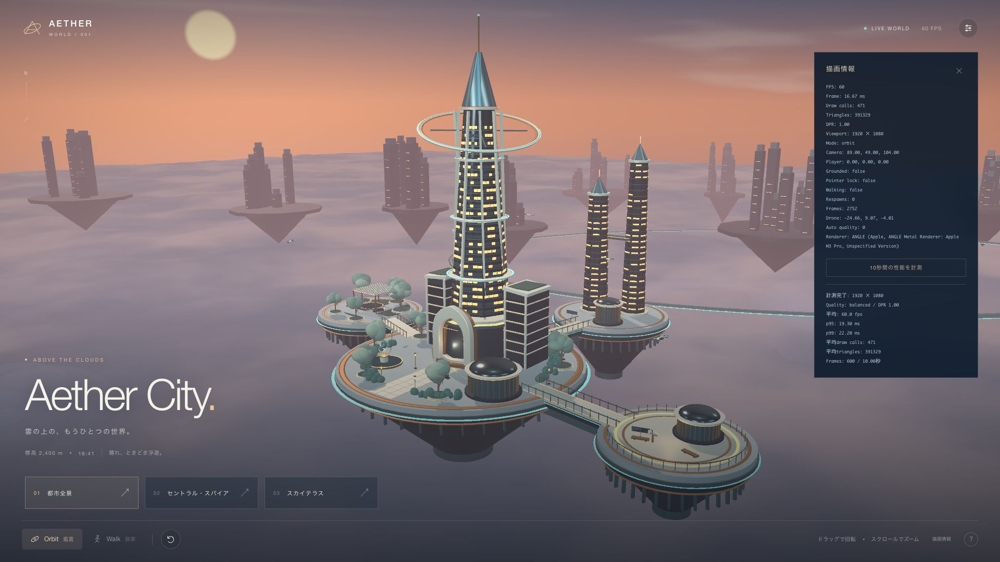

# Aether City

夕暮れの雲海に浮かぶ近未来都市。4つの人工島を橋でつなぎ、鑑賞用のOrbitと物理付きのWalkで探索できます。建築、植栽、空、雲、案内板、ドローンはコードから生成しています。



## 起動

Node.js 24.4.1で検証しました。Node 22.12以降または24以降に対応します。

```sh
cd projects/aether-city
npm ci
npm run dev
```

ブラウザで http://127.0.0.1:5173/ を開きます。Codex内部ブラウザでも利用できます。依存バージョンは完全固定し、`package-lock.json`を同梱しています。npmキャッシュとブラウザ作業環境はこのプロジェクトの`tmp/`に保存します。

```sh
npm run test:logic
npm run test:navigation
npm run typecheck
npm run build
npm run preview
```

本番ビルドは`dist/`に出力されます。プレビューは http://127.0.0.1:4173/ です。相対パスでビルドするため、静的ホスティングのサブディレクトリにも配置できます。ソースの共有先は [yuki-koma2/3D-World](https://github.com/yuki-koma2/3D-World) です。Webサイトへのデプロイは未実施です。

## 操作

| 操作 | 内容 |
| --- | --- |
| Orbit | ドラッグで回転、ホイールでズーム、右ドラッグで平行移動 |
| Walk | 道路・広場・橋の床をクリックして移動。ドラッグで景色をつかむように見回す |
| WASD | 補助の手動移動。クリック移動中に押すと手動操作へ切替 |
| Shift / Space | 加速 / ジャンプ |
| ESC | 移動を停止。床のクリックまたはWASDで再開 |
| R / 復帰ボタン | 選択中の視点に対応する開始地点へ戻る |
| 3つの視点ボタン | 都市全景、スパイア正面、展望台。Walkでは対応する島へ移動 |
| 右上の設定 | 時間帯、時間の進行、光の強さ、霧、画質、自動調整 |
| 右下の描画情報 | FPS、描画負荷、位置情報、10秒間の性能測定 |

Walkはマウスをロックせず、Codex内部ブラウザでも同じ操作です。ドラッグした方向へ景色が動きます。緑の輪がクリックできる床、金色の輪が目的地を示します。移動中のクリックで目的地を変更できます。空・建物・池・植栽・島の外は選択できません。クリック移動は建物や植栽を迂回し、3本の橋を通ります。移動中も自由に見回せます。範囲外へ落下した場合は安全な床へ自動復帰します。

`?seed=271828`で生成Seedを指定できます（初期値271828、0も有効）。同じSeedなら遠景、植栽、窓、雲の配置を再現できます。`?debug`ではLevaの環境調整パネルも表示できます。

## 世界と実装

- 中央島: 八角形のスパイア、構造リブ、階層ごとの窓と水平帯、開口付きアーチ、両翼、反射池、パビリオン。
- 周辺島: 空を眺めるスカイテラス、植栽とパーゴラの庭園、双塔と空中回廊のルミナ・ハーバー。3本の橋で中央島と接続。
- 遠景: 14の島と低詳細の都市群。近景からの距離と霧でスケールを表現。
- 環境: GLSLの夕空・夜空・星・雲海、PMREM環境照明、PBR材質、太陽の影、限定的なBloom。
- 動き: 5機の自律飛行ドローン、回転する庭園彫刻、ホタル、時間帯に追従する空と照明。
- 物理: Rapierの固定床・壁・橋・手すりと、動的なカプセルプレイヤー。CCDによる貫通対策、接地判定、復帰処理。
- クリック移動: 歩行領域の0.6mグリッドでA*探索し、通行可能な区間だけ経路を短縮。体の幅と停止距離を考慮し、目的地は物理床へのレイ判定で選ぶ。経路計算はクリック時だけ実行。
- UI: Zustandで設定と操作モードを管理。描画ループの測定値は可変オブジェクトに書き、DOMは低頻度で更新。

建築の室内、塔の上階、遠景の島は探索対象に含めていません。屋上と空中回廊は外観の構成要素です。主要な4島の屋外を歩いて探索できます。

| 場所 | 役割 |
| --- | --- |
| `src/scene/` | 地形、建築、庭園、案内板、環境、動き、描画効果 |
| `src/controls/` | カメラ、Walk、衝突形状 |
| `src/lib/world.ts` | Seed、島と橋の共通配置、視点、画質、測定値 |
| `src/lib/navigation.ts` | 歩行領域、障害物、経路探索、目印の高さ |
| `src/lib/adaptive.ts` | 自動画質の判断 |
| `src/state/` / `src/ui/` | 操作状態と画面UI |
| `docs/` | 設計、素材情報、検証記録 |
| `outputs/playwright/` | 内部ブラウザで取得した画像と実測結果 |

## 品質と性能

| 画質 | DPR上限 | 影 | Bloom | 雲のインスタンス数 |
| --- | --- | --- | --- | --- |
| 軽量 | 0.85 | なし | なし | 110 |
| バランス | 1.25 | 1024 | あり | 180 |
| 高品質 | 1.65 | 2048 | あり | 260 |

DPRは端末のPixel Ratio以下に制限します。窓・梁・植栽・遠景はInstancedMesh、GeometryとMaterialは共有しています。遠景は低詳細の形状で描きます。物理エンジンはWalkに入る際に遅延ロードし、Orbitの初期転送を抑えます。

43fps未満が4回連続し、起動後8秒を過ぎた場合に自動調整します。DPRを0.2ずつ下げ、0.75まで下げても負荷が続く場合は画質を下げます。画質を手動で選ぶと、そのプリセットの解像度に戻ります。自動的な画質の引き上げは行いません。

軽量設定は影と発光の広がりを省いて速度を優先します。高品質設定は影・雲・輪郭の品質を増やします。バランスを初期設定にしています。10秒間の実測結果、測定条件、検証範囲は[検証記録](docs/verification.md)を参照してください。他のGPUや高DPIでは60fpsを保証できません。

本番ビルドの初期JSはgzip約423KB、Walk追加時のRapierはgzip約842KBです。RapierのWASMを含むチャンクにサイズ警告が出ますが、型チェックとビルドは成功します。

[設計方針](docs/design.md) / [素材・ライセンス](docs/assets.md) / [検証記録](docs/verification.md)
