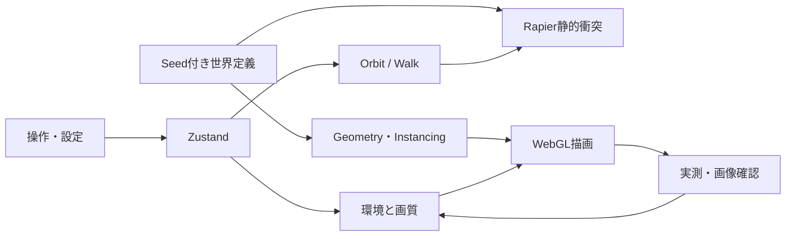

# Aether City 設計と制作計画

2026-10-10 / スケールL（新規3D世界・物理・カメラ・描画品質・ブラウザ検証）。ユーザーの詳細なMissionを承認済み要件・制作方針として扱い、各段階を作って検証する。

## 1. 現状と前提

フォルダは空、Git履歴・既存コード・既存データなし（実際のディレクトリ確認）。Node 24.4.1 / npm 11.5.2、Chromeを確認。ローカルGitのmainを初期化。公開先・リモートは未指定。今回はローカル制作を完了させる。

React 19.3 / Fiber 9.8.1 / Drei 10.7.9 / Rapier 2.2 / Postprocessing 3.1.3はnpmのpeerDependenciesで互換性を確認。Three 0.186.1はpostprocessing 6.39.5の `<0.187.0` 範囲内。`--force`、`--legacy-peer-deps`は使わない。直接依存を固定しlockfileで再現する。

参考: [Fiber公式](https://r3f.docs.pmnd.rs/getting-started/introduction)、[Rapier公式](https://github.com/pmndrs/react-three-rapier)、[Vite公式](https://vite.dev/guide/)。React19はFiber9に対応。実際の描画・操作で互換性を追加検証する。

未確認の仮定: デスクトップのGPU支援が利用できる、1080p/60fpsが成立する。実測して判定する。GPUがソフトウェア描画なら分けて記録する。公開・部署や事業データ・認証・データ移行は対象外（独立した公開用実験）。

## 2. 要求・要件

目的は、公開できる再現可能な実験作品として、鑑賞と探索を両立した夕暮れの都市を作ること。近景（植栽・橋・手すり）、中景（島・庭園・構造物）、遠景（都市シルエット・雲海）を分ける。

| 要件 | 実装 | 確認 |
| --- | --- | --- |
| 深みのある都市 | 中央スパイア、4つの有人島、遠景島、連絡橋、庭園、テラス | 3視点画像・目視修正 |
| Orbit | 回転・ズーム・視点プリセット | マウス操作後の実カメラ座標 |
| Walk | WASD・Shift・Space・Pointer Lock・ESC | 入力と実カメラ・物理位置、解放 |
| 衝突・復帰 | Rapier capsule、島床・橋・壁・手すり、落下復帰 | 壁へ移動・ジャンプ・落下試験 |
| 時間・照明・霧 | 同じ時刻値から空・照明・星・窓を更新 | 夕暮れ／夜、設定の反映 |
| アニメーション | ドローン、ホログラム、時間経過 | フレーム間の位置変化 |
| 描画品質 | 3段階・自動DPR降下・発光閾値Bloom | 実測fps・draw calls・解像度 |
| 再現性 | Seed固定・自作geometry/shader・ローカルアセット | lockfile、build、外部依存なし |
| エラー耐性 | Canvasエラー表示・再読み込み・復帰 | 初期ロード・モード反復・console |

成功条件: 型と本番buildが通り、実ブラウザに3D世界が表示され、探索中に構図が変わり、物理とUIが実際に機能する。機能だけでは完了にしない。

## 3. 設計パターン・案比較

| パターン | 利点 | 代償・成立条件 | 切り戻し |
| --- | --- | --- | --- |
| プロシージャル構築＋共有ジオメトリ | 軽量、Seedで再現、ライセンス処理簡潔、構造に一貫性 | 専用形状と材質の作り込みが必要 | パーツ単位に戻す |
| 外部GLTF中心 | 精細な素材を短期投入可能 | ダウンロード・権利確認・GPUメモリ・様式統一が必要 | モデルを差し替える |
| Raymarchで全体表現 | 空と雲の連続性、表現自由度 | 物理形状との乖離・低GPUで高負荷 | 通常meshに置換 |

| 評価軸 | 松: 高密度GLTF＋体積雲 | 竹: 専用プロシージャル＋雲shader | 梅: 単島＋簡略描画 |
| --- | --- | --- | --- |
| ROI | アセット制作の工数大、最高品質向け | 再利用しやすく実験作品の効果大 | 短期完成、探索の価値が不足 |
| 経営影響 | 個人実験、費用はアセット次第 | 外部課金不要 | 外部課金不要 |
| ユーザー影響 | 読込時間とGPU要件が高い | 読込と操作の均衡 | 要求の世界規模を満たさない |
| 機能影響 | LOD/配信の追加必要 | 物理形状と描画を共通定義 | 拡張時に配置再設計 |
| モジュール影響 | アセット処理・配信追加 | scene/controls/state/ui/libで分離 | 少数だが後の結合が強い |
| 運用 | 大容量、CDN検討 | 静的build・ローカル素材のみ | 静的build |
| 保守 | モデル編集環境も必要 | TSの配置・材質を編集 | 低い初期負担 |
| 相対工数 | 3 | 1 | 0.5 |
| リスク | ライセンス・GPU・asset欠損 | シェーダー・物理を実ブラウザで検証 | 品質要求を満たさない |

採用: 竹。ユーザー指定のプロシージャルgeometryと再現性に合い、今回の全要件を成立させる。体積雲の重い多段raymarchは採用せず、立体の雲塊と複層noiseで空間密度を出す。

## 4. 構成とデータフロー

島と橋の同じ座標から床と物理を作り、浮遊の見た目と探索領域のずれを防ぐ。Walkは低重力の演出に頼らず通常重力を使う。戻る／モード切替／ESCで視点の所有者を一つに保つ。繰返しの窓・梁・灯り・植栽をInstancedMeshにまとめる。フレームループでReact stateを連続更新せず、Vectorを再利用する。

## 5. テスト設計

UT相当: Seed再現、qualityの範囲、配置データの境界を確認。IT: React/Fiber/PBR/postprocessingの初期描画、Rapier床・壁・ジャンプ、カメラの所有権切替。ブラウザ: Orbit drag/wheel、Walkキー入力、ESC、復帰、時間・光・霧・品質UI、3視点。

異常・境界: 読込中にモード変更、Pointer Lock解除後は歩かない、キーフォーカス消失、落下y閾値、UI上のキーを移動として扱わない、低fpsでDPRが下がる、設定値の上限下限、描画エラー表示。

ユーザーシナリオ: 都市全景→正面→Walk→庭園→橋→展望台→夕暮れから夜へ→Orbitへ復帰。運用シナリオ: npm ci→型確認→build→preview→console確認、品質Lowで改善、Rまたはリセットで復帰。実測は1920×1080のviewport、準備完了後の一定時間を使い、装置・rendererを併記する。

## 6. 工数と段階計画

タスクは全てこのローカル制作内で順に実施。期限の約束ではなく相対作業量を示す。最大の不確実性はWebGL環境・初期シェーダー・物理操作なので先行して描画する。

| Phase | 成果物・完了判定 | 相対量 | 依存 |
| --- | --- | --- | --- |
| 1 | 地形と空、Orbit、実ブラウザ初期描画 | 1 | 環境準備 |
| 2 | 多層建築、材質、庭園、光、構図画像 | 2 | 1 |
| 3 | Walk・衝突・ジャンプ・復帰の実入力確認 | 1.5 | 2 |
| 4 | 環境アニメーションと時間・Bloomの動作確認 | 1 | 3 |
| 5 | 3視点の修正、性能測定、最終build・README | 1.5 | 4 |

大規模複数チーム・移行案件には該当しない。基準は全要件、予備はGPU/物理不具合の修正と構図の見直し。低fps時にはDPR・影・Bloomを順に減らし、探索可能な都市を維持する。公開はユーザーのリモート指定後の別工程。変更はプロジェクト単位で戻せる。

## 7. レビュー

- 事実と仮定を分離した。
- 全機能の検証観点と異常系、ユーザー・運用シナリオを記載した。
- 互換性をnpm実情報で確認、実描画を受入条件にした。
- ユーザーの制作指示が実装・起動・検証・視覚修正を含むので再承認待ちは設けない。
- 実装中の決定・Phase確認結果は `verification.md` に追記する。
